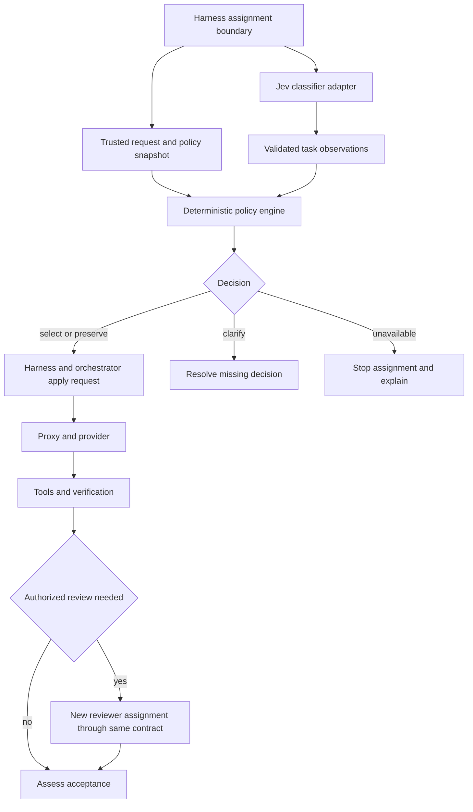

# Model router v2 architecture spec

Status: Draft design baseline. Date: October 31, 2026.

The [official v2 design brief](design-brief.md) selects the architecture and file-level implementation plan. This document describes its component responsibilities and logical interfaces.

The architecture separates task observation, deterministic selection, and execution. Jev classifies assignments. The policy engine selects configurations from an immutable snapshot. A harness adapter applies or blocks the decision, and the orchestrator manages tools, review, repair, and acceptance.

The [decision contract](decision-contract.md) governs precedence and failure behavior. The schemas below describe logical interfaces; concrete implemented shapes are in hooks/v2 and the runtime contracts. The [runtime contracts](runtime-contracts.md) define concrete catalog storage/reader APIs, candidate enrollment, and trusted checks. They are not a claim that a live Jev endpoint or provider supports these shapes; native/runtime qualification is separate.

The [Mods validation report](../r-and-d/03-claude-code-mods-harness-validation.md) establishes an in-process implementation path. V2 selects harness and review-coordinator modules inside the existing plugin. Keeping them separate from pure selection is a component boundary, not a requirement for a separate service. A companion Mod remains a future alternative.

## Components and ownership

| Component | Responsibility |
|---|---|
| Harness adapter | Read trusted controls and request origins, identify assignments, supply requirements, apply permitted changes, and enforce blocking outcomes |
| Classifier adapter | Send the allowed assignment context to Jev, translate its answers, validate values/confidence, and enforce the classification deadline |
| Policy engine | Resolve pins, select a workload rule, evaluate eligibility and authorized alternatives, and return one decision without I/O |
| Catalog and policy data | Store model identities, availability, compatibility, evidence, workload approvals, preferences, and resource rules as distinct records |
| Orchestrator | Dispatch requests, acquire resource reservations when needed, run tools and checks, create authorized reviewer assignments, and manage acceptance |
| Proxy | Carry out the authorized model request, handle bounded transport retries, and expose observable outcomes without choosing a different model implicitly |
| Decision recorder | Distinguish classifier observations, proposed decisions, applied requests, and observed upstream results |



Review execution in this flow requires the coordinator. Mods expose agent registration, spawning, and completion events for that workflow. A hook that only selects models remains one part of it.

## Classifier interface

The input contains the assignment text and relevant context. Trusted controls, pins, credentials, and budgets stay outside the classifier input. Send only the context needed to classify; configured external classification sends that content to its backend.

```ts
type ClassifierInput = {
  prompt: string
  context?: string
}

type Observation<T> = {
  value: T
  confidence: number | null // Finite 0–1; null means unavailable
}

type TaskRole =
  | 'implementation' | 'investigation' | 'review' | 'orchestration'
  | 'visual-analysis' | 'file-scout' | 'simple-answer' | 'explanation'

type ClassifierOutput = {
  role: Observation<TaskRole>
  specification: Observation<
    'explicit' | 'inferable' | 'unresolved' | 'unknown'
  >
  verification: Observation<'executable' | 'partial' | 'judgment' | 'unknown'>
  executionSpan: Observation<'bounded' | 'dependent-steps' | 'extended' | 'unknown'>
  consequence: Observation<'reversible' | 'consequential' | 'unknown'>
}
```

The adapter maps these fields to Jev questions and normalizes the returned answers. API transport details remain in that adapter. Jev names no models and grants no execution, fallback, or review permission. Policy combines its observations with trusted requirements. Policy must not interpret a missing observation or confidence as a confident low-demand result.

For example, an exact replacement in three files might yield implementation, explicit specification, executable verification, bounded execution, and reversible consequence, with high confidence. The policy can then choose an approved mechanical-work configuration. The classifier does not choose Haiku itself.

## Policy interface

The policy input adds the current request, per-field origins, controls, scoped pins, mandatory requirements, catalog/admission records, resource snapshot, fallback authorization, and versions. [Decision inputs](decision-contract.md#2-decision-inputs) define the complete snapshot.

The following union shows the outcome-specific payload. Every outcome also carries assignment identity, versions, snapshot fingerprint, override sources, reason codes, eligibility diagnostics, and review disposition as specified in the contract.

```ts
type Configuration = {
  model: string // Exact catalog/request identity
  effort: {
    source: 'explicit' | 'inherited' | 'harness-default'
    value: string | number | null // Preserve numeric caller values literally
  }
}

type OutcomePayload =
  | { outcome: 'select'; configuration: Configuration;
      changes: { model?: string; effort?: string } }
  | { outcome: 'preserve'; configuration: Configuration;
      qualification: 'verified' | 'unverified' }
  | { outcome: 'clarify'; question: string }
  | { outcome: 'unavailable'; blocker: string; remedy: string }

type ReviewDisposition = {
  disposition: 'not-requested' | 'recommended' | 'required'
  trigger: string | null
  distinctFamily: boolean
}
```

These types are a compact interface outline, not a complete storage schema. A preserve result's `verified` status means the available checks establish eligibility for this assignment; it does not certify the completed artifact. A select result must include any resource reservation requirements in its decision metadata.

The selection sequence is: resolve authority and fixed fields; check known hard constraints; clarify material missing decisions; resolve pins or a workload rule; choose a primary configuration; check eligibility; then evaluate only authorized alternatives if the primary fails. The same normalized snapshot must produce the same result.

## Pin flow

Pins enter through trusted user controls or explicit orchestrator metadata. For example, this user intent fixes both fields for a session:

```json
{
  "scope": "session",
  "model": "claude-opus-5-5",
  "effort": "medium"
}
```

The adapter adds the pin's origin and scope identity. It resolves assignment over session over persistent pins for each field. A task-specific model pin can replace the session model without clearing a session effort pin; the resulting pair must still qualify.

An automatic selection made earlier is not a manual pin. If origin is unknown, preserve the field and explain the limitation. A switch that is off forbids mutation. A pin that conflicts with a fixed outgoing field produces an explicit failure rather than a hidden change. Use router-owned controls for reliable pin intent. Native `classic.PostModelSwitch` can report successful changes and their source; account for default selection, fast mode, SDK changes, automatic fallback, and resume before mapping an event to a pin. Live native-selection and effort-origin checks remain necessary.

## Execution and review flow

1. Reject known intake failures at `prompt.submit`. Use `turn.start`'s `turnId` for canonical assignment state and tie classifier output to it; discard ambiguous or late output. A queued-prompt implementation still needs a live check.
2. Evaluate the decision before dispatch at `turn.step`. For selection, acquire any required resource reservation. For clarification or unavailability, use the event's supported short-circuit shape: a prompt drop, a spawn denial, or a synthetic streamed policy response with no tool calls. Preserve the policy outcome separately from the stream's stop reason.
3. Keep selection stable across the tool loop while checking actual outgoing targets for authorized fallback. Record requested values separately from observable upstream identity and effective effort. Native/provider fallback must conform to the contract before application; a later step observation cannot prove the first substitute request was authorized.
4. Run available deterministic verification. A reproducible failure normally returns to the author for bounded repair.
5. When authorized, create a fresh, non-fork reviewer assignment using the same policy. Set effort, tool permissions, and run limits on its registered type. `$.agent.spawn` returns after startup; collect the answer through the matching completion event, with bounded lifecycle handling. Supply requirements, artifact/diff, context manifest, and executed test evidence tied to the artifact revision.
6. Verify material findings and perform any bounded repair. Recheck changed artifacts. Acceptance depends on required checks and completed required review.

Each substantive review finding contains its requirement or invariant, artifact location, consequence, evidence status, and smallest useful reproduction or verification step. Distinguish suggested tests from executed results. Record actual reviewer identity where observable; unknown identity cannot establish required family independence.

Review execution state is separate from the routing disposition. The orchestrator tracks whether review is pending, running, completed, or blocked, and invalidates affected evidence when the artifact changes. A completed review can report no supported findings. A recommendation alone never marks review completed.

After repair, deterministic checks do not renew independent review. Use only the authorized, qualified targeted-closure transition in [decision-contract §8](decision-contract.md#8-review-disposition). Bind the new result to the repaired revision; broader changes, new material findings, stale context, or inconclusive verification keep acceptance blocked. Repairs keep the candidate ID and attempt counters.

The [checkpoint interface](runtime-contracts.md#review-checkpoints) determines when the coordinator starts review of a multi-turn candidate. Serialize launch intent and preserve attempt counters across reload and revisions; do not infer completion from a turn boundary. [Assignment/pin purpose](runtime-contracts.md#assignment-and-pin-purpose) separates execution controls from reviewer selection.

The [candidate interface](runtime-contracts.md#candidate-enrollment) supplies explicit artifact/context paths, requirements, and check IDs from trusted enrollment. The [trusted-check interface](runtime-contracts.md#trusted-checks) supplies provenance-verified commands; run them through the governed tool path and invalidate evidence if checks change covered content. These inputs cannot originate from classifier or model prose.

A `turn.complete` annotation cannot retract an answer that already streamed. The initial acceptance boundary is a router-managed artifact record; the brief defines its revision binding and explicit acceptance action. Buffering and universal publication guards are deferred. Guard error paths before `next`; streamed content and completed external actions cannot be undone. Include fail-closed error handlers where policy enforcement requires them.

## Data and failure boundaries

Keep availability, compatibility, evaluation evidence, workload approvals, preferences, and resource policy separate. Discovery updates availability only. Approval names a configuration, workload, environment, and operating conditions. Dynamic credentials and account usage stay outside committed model evidence.

Use [catalog document version 2](runtime-contracts.md#catalog-document-version-2) and its deterministic v1 migration. Keep the lossless legacy snapshot separate from v2 observations; imported records grant no workload approval. Legacy consumers use `parseCatalog` for the validated legacy projection, the v2 adapter uses `parseCatalogV2`, and generation uses `parseCatalogDocument` to preserve the full document.

Start with static provider preference. Add locally enforced budgets only where accounting can support their units and scope. Unknown live quota remains unknown. If hard budget enforcement needs a reservation, the orchestrator owns the atomic accounting operation; the policy engine only evaluates the snapshot and requests the reservation.

Classifier failure usually preserves the request, subject to mandatory checks. Invalid policy data blocks the redesigned policy. An unavailable preferred model does not escape to Basic routing. Transport retries retain identity and effort; substitution requires exact authorization and an explicit retry boundary. Continuation must preserve tool state without silently replaying external actions.

## Integration and rollout

The existing code has main-turn and subagent hooks, task preferences, a catalog, and separate mutation controls. It does not yet implement these logical interfaces or the review workflow. The current router skips subagent `turn.step` events and does not apply subagent effort preferences. The harness does expose definition/registration effort, the Agent tool's invocation effort, and subagent step effort. The narrower `$.agent.spawn` interface has no effort argument in the inspected declarations. Validate the chosen path's timing, environment caps, and proxy translation.

Hooks active when an agent is spawned can be skipped on its loop. Put reviewer restrictions on the definition and validate current re-entry behavior; do not depend solely on the spawning Mod observing every child request. Keep long-lived coordinator state outside an arbitrary pending promise in a blocking hook. Headless operation, cancellation, later Mods, and managed policy also need explicit handling.

First evaluate v2 in shadow mode alongside the active policy. The proposed `policyEngine` selects `legacy`, `v2-shadow`, or `v2`, defaulting to legacy. Current Observe mode still applies Basic routing and must retain that meaning. Keep its classifier request unchanged; a separate live v2 classification can add explicit evaluation overhead. Shadow records never appear as applied changes. Enable application only after the adapter can enforce the outcomes required by its policy. Keep legacy routing as an explicit rollback selection.

The [validation plan](validation.md) covers hook support, pin origins, identity and effort translation, review orchestration, telemetry, and quality comparisons. Those findings can change the integration design while preserving explicit control and observable failure behavior.

## Offline implementation status — October 31, 2026

Phases 1–7 now have implementation and offline checks. This does not enable production v2: legacy remains the default, real environments/approvals remain empty, native origin/context/token-cap/fallback qualification and governed-check terminal success remain unavailable, and no live quality experiment was run. Review mode alone grants no spend; unsupported author/reviewer/repair/verification paths hold. See the [final offline checkpoint and remaining live gates](validation.md#phases-57-offline-checkpoint), [runtime integration](runtime-contracts.md#phases-57-native-integration) and [usage/rollback](../usage/router-controls.md#v2-controls-and-pins) for the implemented boundary.
