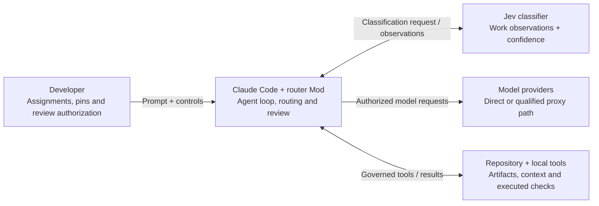
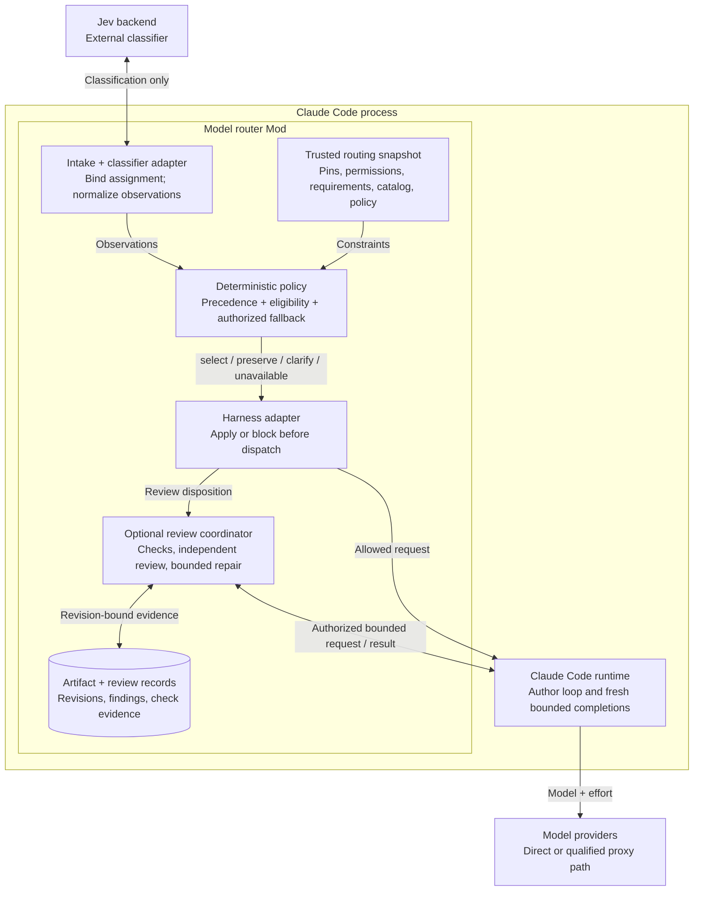

# Model router v2: C4 overview

Status: Implemented component boundaries, revised November 1, 2026. The cross-family sequence is illustrative, not recorded live evidence; default workers are fresh bounded native completions.

Read this as two zoom levels: the surrounding systems, then the components inside the Mod. The sequence diagram follows one concrete request through those components. [C4](https://c4model.com/) separates system context, containers, components, and code. Here, the router runs inside the Claude Code process; its modules are not separately deployed services. The component view is the useful next zoom after context.

## System context



Jev describes the work. The router's deterministic policy chooses a configuration or returns a blocking outcome. Claude Code owns execution and tool permissions. The router enforces its requested pins and router-selected alternatives; provider substitutions and ordinary execution/context limits are host-owned. Observed mismatches remain visible, not certified as safely prevented.

## Router component view



The gate returns `clarify` or `unavailable` before dispatch. `select` and permitted `preserve` decisions continue through the runtime. Every reviewer assignment uses the same routing/eligibility contract as the author assignment.

The optional coordinator enrolls an explicit candidate and waits for a user review request or trusted authorized workflow checkpoint. A per-turn review disposition does not launch a reviewer. At the checkpoint, the coordinator runs trusted checks through the governed tool path and obtains authorized independent review. Acceptance is an explicit action on the exact current artifact revision. A changed artifact makes prior evidence stale. After repair, deterministic checks alone cannot renew review; authorized independent targeted closure can do so within the recorded findings and affected invariants. Acceptance does not commit or publish.

## End-to-end request: pinned author and independent review

This illustrative example assumes eligible Sonnet/Astra configurations, separately verified cross-family behavior, trusted check definitions, and explicit finite allowances. Configure reviewer/family requirements through trusted `reviewPolicyJson` and enroll an explicit manifest with `/router candidate register`; prose below grants none of that authority. `C1` is shorthand for the resulting candidate ID. This is not a claim that the default Opus reviewer is cross-family.

First, pin the author for the next user assignment:

```text
/router pin model claude-sonnet-5-5 --scope next
/router pin effort medium --scope next
```

Then submit:

> Prevent duplicate profile saves while a request is in flight. Add regression tests. Require independent cross-family review before acceptance. Authorize one review, one repair, and independent targeted verification.

```mermaid
sequenceDiagram
    actor You
    participant Router as Router policy + gate
    participant Jev
    participant Author as Sonnet (medium)
    participant Repo as Repository + checks
    participant Coord as Review coordinator
    participant Reviewer as Independent Astra reviewer

    You->>Router: Request + next-assignment pins
    Router->>Jev: Classify the assignment
    Jev-->>Router: Implementation, explicit requirements,<br/>executable verification, bounded work
    Router->>Router: Bind author pins, check complete configuration
    Router->>Author: Dispatch with pinned Sonnet + medium
    Author->>Repo: Implement guard + regression tests
    Repo-->>Author: Tests pass

    Coord->>Coord: Enroll authorized candidate C1, revision A
    Coord-->>You: Candidate C1 registered, review pending
    You->>Coord: /router review C1
    Coord->>Repo: Run trusted configured checks
    Repo-->>Coord: Passing evidence bound to revision A

    Coord->>Router: Request independent reviewer assignment
    Router->>Router: Check capability, family, path and allowance
    Router->>Reviewer: Start fresh capped tool-less completion
    Coord->>Reviewer: Requirements, diff, context and executed checks
    Reviewer-->>Coord: Keyboard submission bypasses guard,<br/>reproduction produces two saves

    You->>Coord: /router repair C1
    Coord->>Author: Authorized repair of confirmed finding
    Author->>Repo: Guard shared submit handler, add reproduction test
    Coord->>Coord: Revision B makes prior evidence stale
    Coord->>Repo: Rerun required checks for revision B
    Repo-->>Coord: Pass, repeated submission makes one API call

    You->>Coord: Inspect repair; /router verify C1 --confirm-scope
    Coord->>Router: Request authorized targeted verification
    Router->>Router: Recheck verifier eligibility and allowance
    Router->>Reviewer: Dispatch independent targeted verification
    Coord->>Reviewer: Original finding, manifests, repair diff,<br/>requirements and fresh check evidence
    Reviewer-->>Coord: Finding closed, no new material issue
    Coord->>Coord: Record current review evidence, C1 becomes ready

    You->>Coord: /router accept C1
    Coord->>Coord: Recompute digest, verify current checks and review
    Coord-->>You: Accepted revision B, no commit or publication
```

The next-assignment pins bind the author configuration. They do not select the independent reviewer. Reviewer and targeted-verification assignments each pass through the same routing contract with their own eligibility and allowance checks. The reviewer initially receives no persuasive author rationale or self-assessment.

If the pinned configuration is ineligible, stop without silent substitution. If required review is unavailable, targeted verification exceeds its authorized scope, or a new material issue appears, acceptance remains blocked. Passing deterministic checks alone cannot renew review after repair. See the [review contract](decision-contract.md#8-review-disposition) and [candidate enrollment contract](runtime-contracts.md#candidate-enrollment).

## Ownership at a glance

| Part | Owns |
|---|---|
| Jev | Observations about work; no model, pin, budget, or permission authority |
| Pure policy | One deterministic decision from the supplied snapshot |
| Harness adapter | Assignment binding, permitted mutations, blocking, lifecycle handling |
| Claude Code runtime | Model requests, agent loops, tools, host permissions |
| Review coordinator | Authorized review lifecycle, bounded follow-up, explicit acceptance |
| Catalog and records | Model evidence/approvals separately from artifact/check/review evidence |

Legacy remains the default; configured v2 routing and separately permitted subagent effort are available. Automatic review additionally requires exact candidate/stage grants, not mode alone. Context/caps/provider behavior belong to the host. See current validation for tested paths and unmeasured quality claims.

For detail, see the [design brief](design-brief.md), [decision contract](decision-contract.md), [runtime contracts](runtime-contracts.md), and [validation plan](validation.md).
