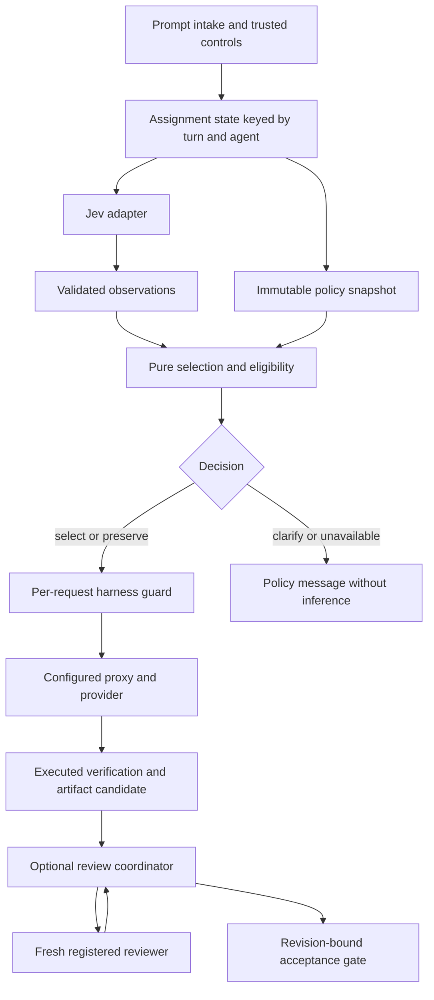

# Model router v2 design brief

- **Author:** Codex, consolidating owner direction and project research
- **Status:** Proposed v2 design baseline; implementation and rollout are not approved by this document
- **Date:** 2026-10-31
- **Scope:** Claude Code Mod, deterministic routing, explicit controls, and optional independent review

## Overview

V2 replaces competing task-preference and tier-selection paths with one inspectable decision contract. Jev describes the assignment. A deterministic policy chooses a qualified model and effort. A Claude Code Mod applies the decision and can coordinate authorized independent review.

The design ships in the existing `jev-model-router` plugin. Pure selection, harness integration, and review coordination remain separate modules. This keeps one installation and one set of user controls without requiring an external orchestration service.

This is the entry point for the v2 design. The supporting product and architecture documents explain the components; the decision contract owns routing semantics; the validation plan owns remaining evidence gates. Research observations do not grant workload approval. See Additional Resources for their canonical locations.

## The Problem

The current plugin can classify tasks, apply preferences, and change model requests. However, task preferences and Basic risk/tier routing use separate selection paths. A role such as implementation does not establish whether requirements are unresolved, checks are trustworthy, dependencies are extensive, or a mistake is consequential.

Users also need manual choices to survive routing. Changing to another model can lose cache reuse, exceed a scarce provider allowance, or invalidate an intended independent review. A successful transport request alone does not establish tool compatibility, effective effort, or task quality.

The harness findings make the constraints concrete. Subagent effort has supported paths, but the Mods spawn interface has no direct effort argument. Guards must act before dispatch and handle their own failures. Post-turn review cannot retract text already streamed. Engine and proxy fallback can run beneath a request hook. V2 must state where it enforces a rule and where evidence remains insufficient.

## Goals

1. Apply one eligibility and override contract to every v2 automatic selection, including reviewer and fallback configurations.
2. Respect independent main/subagent model and effort controls and explicit pin scope. Record why a request changed or stayed unchanged.
3. Separate specification uncertainty, verification strength, execution span, and consequence. Clarify missing behavior instead of treating it only as a need for more computation.
4. Prefer Claude among otherwise suitable candidates while permitting explicit choices and qualified specialist assignments. Do not claim measured cost optimization without consumption evidence.
5. Support bounded, evidence-producing independent review inside the Mod, with acceptance tied to the artifact reviewed.
6. Make replay deterministic, preserve a visible rollback path, and enable live application only for validated request paths.

## Non-Goals

- A learned universal difficulty score or automatic routing changes from leaderboards.
- Universal model review, model voting, or repeated repair loops without new evidence.
- Subscription exchange rates inferred from API prices, or live quota optimization without reliable telemetry.
- General interception of every publication path or review of text before it streams. Response buffering is outside the initial delivery.
- Automatic model approval from discovery, family names, or a basic text/tool smoke test.
- Changing user credentials, shell launchers, proxy settings, or existing routing during this design work.

## Open Questions

The architecture below is selected. The following are release evidence gates, not reasons to reopen settled component boundaries:

| Gate | Evidence required before enabling the affected path |
|---|---|
| Native selection mapping | Live picker, default, fast-mode, SDK, clear/resume, and effort-origin behavior on each supported surface |
| Model and effort forwarding | Exact outgoing payload, relevant caps, tool/image round trips, and observable resolved identity through the installed proxy |
| Fallback enforcement | Prevention or explicit authorization of the first substitute request, including failures beneath `next` |
| Review lifecycle | Real registered reviewer restrictions, re-entry, early completion, cancellation, timeout, and stale-artifact handling |
| Catalog admission | Workload approvals, verified context limits, freshness bounds, output reserves, and environment versions for the initial candidate set |
| Quality and resources | Paired completion/repair outcomes and reliable units before numerical quality or budget claims |

If a mandatory gate fails, preserve an inherited request only where the contract permits it; otherwise return `unavailable`. Keep unsupported enforcement in shadow evaluation. A missing fact never becomes a passing check.

## Critical User Journeys

### CUJ 1: Route a specified assignment

- **Given:** v2 application is enabled, mutation controls permit a change, and an approved configuration fits the required capabilities.
- **When:** a user submits a form implementation with explicit references and acceptance checks.
- **Then:** Jev returns observations, the policy selects an eligible configuration, and the Mod holds that choice through the assignment. Per-request checks still enforce identity and authorized fallback. The record distinguishes requested and observed values.

### CUJ 2: Pin a session and override one assignment

- **Given:** the user pins an eligible model and effort for the current conversation.
- **When:** one assignment receives a more specific model pin.
- **Then:** that model field takes precedence while the session effort remains fixed. The complete pair must qualify. Ending the assignment restores the session pin; an incompatible pair produces an explicit failure without silent normalization.

### CUJ 3: Request clarification or report unavailability

- **Given:** an authorization requirement is unresolved, or a pinned provider is known to be exhausted.
- **When:** the policy evaluates the assignment.
- **Then:** it returns `clarify` or `unavailable`. The adapter blocks before dispatch with the event's supported result shape. Classification failure alone preserves a request unless an existing mandatory constraint prevents it.

### CUJ 4: Complete required independent review

- **Given:** automatic review is authorized, the reviewer path qualifies, and policy requires review of a router-managed artifact.
- **When:** the author produces a candidate and its check evidence.
- **Then:** a fresh reviewer inspects the revision and evidence. Supported findings receive bounded verification/repair. The coordinator accepts only the current artifact with completed required checks and review. A blocked reviewer leaves acceptance pending or blocked; the author's final text is not an acceptance signal.

### CUJ 5: Evaluate and roll back

- **Given:** legacy routing remains active and the user opts into v2 shadow evaluation.
- **When:** v2 produces a different result or cannot complete.
- **Then:** the legacy request remains the applied request and both policy identities appear in diagnostics. A later switch back from v2 application restores the selected legacy policy at the next assignment boundary.

## Technical Plan

### Components and data flow

Use one plugin with three execution boundaries: pure policy, a harness adapter, and an optional stateful review coordinator. Retain the existing plugin identity so saved credentials and options continue to resolve. Add no service or runtime package dependency.

The classifier never names models, grants fallback permission, or sets budgets. Selection performs no I/O. The adapter supplies facts and applies allowed field changes. The coordinator owns reviewer lifecycle and artifact acceptance. A role preference never bypasses a capability gate.

### Classification and policy records

Keep the logical classifier schema already defined in the architecture spec: prompt and optional relevant context in; role, specification, verification, execution span, and consequence out, each with finite confidence or unknown confidence. The TypeSafe and Gateway adapters translate their wire formats independently. Invalid or missing dimensions never become confident low-demand values. A backend that supplies only a legacy tier cannot authorize a v2 dimension-based change.

Use `0.8` as the initial per-required-field confidence threshold and retain the existing 800 ms classifier deadline as the initial latency ceiling. These are versioned pilot values, not calibrated performance claims. Cancellation or an expired assignment invalidates late results. Trusted requirements can enforce a constraint without classifier confidence.

The policy snapshot includes assignment and retry-lineage IDs, current model/effort and their origins, mutation permissions, scoped pins, mandatory capabilities, environment identity, resource restrictions, authorized alternatives, and policy/catalog revisions. The decision is `select`, `preserve`, `clarify`, or `unavailable`, with reasons, eligibility diagnostics, and a separate review disposition.

Carry numeric inherited effort literally; do not map it onto a named scale. An unknown value cannot satisfy a required effort. The complete resulting model/effort pair must qualify, including when one field is fixed.

Keep distinct catalog records for identity/availability, compatibility, evaluation evidence, and workload approval. A configuration identifies model, effort, request path, environment bounds, and operating conditions. Preferences and resource policy remain separate inputs. Upgrade the editable catalog and its generated TypeScript representation together; no JSON import is introduced into the Mods runtime.

Every approval must name freshness bounds, context margin/output reserve, and compatible versions where those are required. Missing values fail the relevant eligibility check. Populate actual capacity and approval facts through the validation plan; do not seed them from model names or convert existing smoke tests into broad workload approval.

### Selection and override rules

The decision contract remains normative. In precedence order: hard constraints; hook limits and mutation permissions; assignment/session/persistent pins per field; approved workload rule and configured preference; soft Claude preference; stable configuration ID for remaining ties.

Resolve the primary configuration before testing alternatives. A list of suitable models does not grant fallback permission. Default substitution permission is none. An authorization names exact alternatives and failures, with at most one dispatched substitution per assignment lineage in the initial policy. Checking a rejected alternative does not spend that limit. A pin needs authorization that explicitly covers it. No legacy escape exists inside an enforced v2 decision.

Unknown live quota permits the static provider policy to operate; it does not establish remaining capacity. Start with static Claude preference. If a user configures a hard budget that cannot be accounted for or reserved reliably, return `unavailable`; do not approximate successful enforcement with an unprotected store update. Cross-session budget enforcement is not part of the initial delivery.

### Harness lifecycle and enforcement

Use `prompt.submit` for known intake failures and attachment facts. Use `turn.start` and its `turnId` as the canonical main/subagent assignment boundary. Classify the final assignment text before the first permitted request. For an agent whose model must be decided at spawn, retain that decision as provisional state and bind it to the resulting agent/turn; never apply another spawn's result when the association is ambiguous.

At `turn.step`, apply the stored selection without reclassifying tool results. Recheck the actual target, mandatory restrictions, cancellation state, and permitted fallback. A changed target is not permission to repin or overwrite the user's intent. Missing native association preserves only where the contract permits preservation.

Block before calling `next`: return a prompt drop, spawn denial, or synthetic streamed policy response with no tool calls. Keep `clarify`/`unavailable` in coordinator state even if the response uses a normal stream stop marker. Give enforced guards fail-closed error handlers. If dispatch already occurred, report what happened; a later error handler cannot undo it.

Unsupported engine/proxy fallback must be disabled or explicitly reconciled before v2 application on that path. Do not rewrite local proxy settings automatically. Transport retries preserve identity and effort, use a finite configured count/deadline, and never replay external tools. A continuation on a different model requires authorization and demonstrated context/tool-state compatibility.

### Controls and pins

Add the following controls while retaining existing legacy settings and permissions:

| Control | Initial value and meaning |
|---|---|
| `policyEngine` | `legacy`; alternatives `v2-shadow` and `v2` select shadow evaluation or application |
| `routeSubagentEffort` | `false`; permission for automatic subagent effort changes, independent of model routing |
| `reviewMode` | `recommend`; `off` suppresses automatic recommendations, while `automatic` permits the approved standing workflow |
| `persistentModelPin`, `persistentEffortPin` | Empty/unset; user-managed defaults for future assignments |
| `verificationChecksJson` | `{"schemaVersion":1,"checks":[]}`; provenance-verified user or managed-policy check definitions, as specified in the [runtime contracts](runtime-contracts.md#trusted-checks) |

Router-owned pin commands are the initial reliable interface. Extend `/router` with `pin model <id>` and `pin effort <level>`, each accepting `--scope next|session|persistent`; omitted scope means session. `unpin model|effort` removes that field at the named scope. `next` means the next eligible user assignment, not the control command itself or an unrelated background notification. Trusted coordinator metadata can address an existing assignment directly. Mutations still respect routing switches; a pin conflicting with a fixed outgoing field returns `routing_fixed`.

`status` shows effective pins and their sources, fixed fields, policy engine, review mode, and the last applied decision. These commands and fields are new v2 interface decisions, not existing supported syntax. Router-owned pins initially target execution work; independent review and targeted verification use review-purpose assignments and separately resolved pins, as defined in the [runtime contracts](runtime-contracts.md#assignment-and-pin-purpose).

Scope session pins to the harness conversation identity; preserve them across Mod reload and restore them only when resuming that identity. A clear or branch with a new identity receives no copied session pins. Handle lifecycle events explicitly rather than treating `session.start` as the only reset signal. Persist only pin values and metadata in the plugin store; credentials stay in the existing user stores.

Native pin mapping remains gated by live evidence. Record a verified successful manual selection after its post-switch event. Do not convert automatic fallback, resume restoration, SDK control, default selection, or fast-mode promotion into persistent intent based only on a coarse event source. With unknown origin, preserve the field. Router-owned pins remain available when native mapping is unsupported.

### Independent review and acceptance

Keep the coordinator in this plugin, as a separate module. Automatic review starts only with both standing authorization and a qualified reviewer path. An explicit `/router review` requests one review; it does not change the standing review mode. Proposed triggers remain authorization boundaries, destructive migration, concurrency/idempotency, consequential architecture assumptions, and material uncertainty after clarification. They recommend review by default; explicit user requirements or approved standing policy can require it.

Enroll candidates through `/router candidate register <manifest-path>` using the runtime-contract input and trusted-origin checks. `/router review <candidate-id>` selects that candidate; the no-argument form is valid only when exactly one current candidate exists. Missing or ambiguous enrollment returns `clarify`, and invalid scope or unavailable required checks returns `unavailable`. Candidate data cannot supply commands or waive policy. Trusted check definitions come from provenance-verified user or managed-policy configuration.

Register fresh non-fork reviewer types with model, effort, a relevant tool allowlist, and finite run limits. Supply requirements, artifact/diff, relevant caller/context manifest, and executed checks. Initially withhold persuasive author rationale and self-assessment. Put restrictions on the definition, because hooks active during spawning can be skipped. An unknown effective identity cannot satisfy required cross-family independence. Cross-family execution uses a qualified existing proxy path; external CLI workers are deferred.

Track `candidate`, `checking`, `reviewing`, `repairing`, `ready`, `accepted`, `blocked`, `cancelled`, and `stale` states. Spawn returns an agent ID, not the completed answer. Handle completion that arrives early, denial, error, interruption, and timeout without accepting the artifact or starting recursive reviews. Do not hold a blocking hook open on an unbounded coordinator promise.

The initial acceptance boundary is a router-managed artifact record. Its identity includes base revision, explicit file/content manifest, relevant context, check evidence, and policy/reviewer configuration. Recompute the affected digest before accepting. A changed artifact or required context invalidates the review/check evidence and returns it to `stale`.

Expose `/router accept <candidate-id>` as the controlled acceptance action. It succeeds only when current required checks and review are complete and no material finding remains unresolved. It neither commits nor publishes. The author's streamed answer may precede this action and must remain labeled unaccepted. V2 does not claim to stop Git commands outside this workflow; universal publication enforcement and buffered chat are outside initial scope.

Each substantive finding records a requirement/invariant, location, consequence, evidence status, and verification step. A completed review may report zero supported findings. Bound the initial workflow to one review pass, one repair pass, then targeted verification; further escalation needs unresolved material evidence and separate authorization. A recommendation alone spends no model allowance.

After repair, deterministic checks alone do not renew required independent review. A bounded independent targeted-verification step may renew review for the exact repaired revision only when the approved workflow explicitly authorized that step, its reviewer meets the required independence and capability checks, and every repair change falls within the originally recorded findings and affected-invariant scope. The verifier receives the original findings, old and new revision manifests, the repair diff, relevant requirements/context, and fresh executed check evidence.

Record a new revision-bound verification result. Mark the repaired candidate ready only if the verifier confirms closure of every material finding, reports no new material issue, and all current required checks pass. Broader changes, changed unrelated context, inconclusive verification, absent authorization, or a new material issue leave acceptance blocked pending a separately authorized review. Never carry the old review's completed status onto the repaired revision.

This targeted closure step is distinct from the single broad review pass and single repair pass. It is still a model assignment with an explicit resource allowance and finite operating limits. If it was not authorized, the bounded workflow ends blocked; it does not silently add another review or waive the requirement.

### Review checkpoints

Evaluate routing per assignment; launch review only at a candidate checkpoint. Several turns may contribute to the same explicit artifact scope. `/router review <candidate-id>` supplies a user checkpoint; automatic mode uses the trusted [checkpoint interface](runtime-contracts.md#review-checkpoints) and existing standing authorization. Classifier risk, ordinary edits, elapsed time, and `turn.complete` never launch review on their own. Required review blocks acceptance while waiting.

Run required checks before review, deduplicate launch intent by candidate/revision/stage, retain attempt counters across turns and repairs, and discard stale results. A reload with uncertain dispatch does not start another reviewer blindly. The decision contract owns review-mode and pin-purpose semantics; the runtime contract owns checkpoint inputs and recovery.

### Shadow operation and rollout

`legacy` preserves existing Basic/Custom/Observe behavior. `v2-shadow` leaves that active policy and its classifier request unchanged and records a separate v2 result. A live shadow evaluation may require an additional classifier request; opt-in and reporting must make that overhead explicit. Offline replay uses saved snapshots without inference. Never add v2 questions to a legacy classifier call and claim an unchanged experimental baseline.

`v2` applies only the v2 contract on validated paths. Switching policy engines takes effect at the next assignment boundary. Existing in-flight review records remain explicit until cancelled or completed; a rollback does not magically approve them. Release in stages: offline replay and probes; opt-in shadow; one qualified execution path; qualified subagent effort; authorized review coordination. Default application and automatic review remain disabled until their gates pass.

### Comparison configurations

Retain one plugin with a native engine selector and the existing legacy mode selector. Initial comparisons use manual `legacy/basic`, `legacy/custom`, and `v2` configurations. Observe and v2 shadow compare decisions; they do not execute a counterfactual solution. V2 shadow performs no v2 review/check/reservation side effects. Exact historical releases require preserved source/configuration snapshots; retaining legacy policy is not an archive of every plugin version.

Tag records with applied/proposed engine, legacy mode where relevant, policy/catalog revisions, pins, review settings, and observed environment. Compare completed work in isolated trials from identical starting states; report mixed-policy candidates separately. Automatic allocation and statistics are deferred. See the [implementation handoff](implementation-handoff.md#comparison-testing) for the initial comparison rules.

## Alternatives Considered

| Alternative | Strongest case for it | Cost or failure condition | Decision |
|---|---|---|---|
| Keep role-to-model mappings as the complete selector | Few rules, easy to explain, low implementation cost | Role alone misses missing requirements, consequence, and capability fit; existing paths can bypass shared checks | Retain roles as lookup keys, with dimension-based rules and shared eligibility |
| Always use a strong model, or learn a universal routing score | A strong default reduces classification mistakes; a learned score could adapt after enough trials | Wastes scarce capacity or hides poorly measured trade-offs; neither guarantees requirements or review quality | Keep always-Sonnet/Opus as evaluation baselines; defer learned selection |
| Put review orchestration in a service or separate Mod now | Independent lifecycle and deployment can simplify isolation | Adds credentials, transport, installation, and recovery responsibilities before they are needed | Use modules in the existing plugin; revisit separation if deployment or isolation requires it |
| Review with a conversation fork or text completion only | Cheap context reuse or a small isolated call | A fork carries the author's narrative and session model; a text-only completion cannot run verification tools | Use fresh registered tool-capable reviewers for the initial coordinator |
| Buffer every final answer or guard all publication commands | Can enforce review before a defined release when implemented completely | Adds latency, stream/tool complexity, and incomplete command recognition; cannot govern actions outside the harness | Start with explicit artifact acceptance; defer buffering and universal publication guards |

These choices do not establish that the selected policy outperforms the baselines. That requires completion trials at the operating budgets actually used.

## Non-Functional Requirements

**Determinism and recovery.** Version snapshots and decisions, including assignment/pin purpose and coordinator launch intent. Resolve same-priority rule conflicts as invalid configuration. Keep bounded assignment/coordinator records and reject stale callbacks after clear, resume, cancellation, or reload. A reload restores pinned intent and explicit review state; it never restores an unverified in-flight action as completed. Treat an interrupted reviewer as incomplete until its state can be established.

**Latency and resource use.** Classify once per assignment; mandatory per-request checks do not trigger inference. Enforce the initial classifier deadline and discard late results. Record shadow overhead, model-switch cache effects, retries, repair, and review consumption separately. Do not infer savings from a model label. Long-lived work runs through bounded coordinator events rather than an unbounded promise inside a blocking hook.

**Privacy and authority.** Send only relevant prompt/context to the configured classifier. Keep pins, provider restrictions, and budgets outside classifier authority. Decision logs omit raw prompts, keys, private account details, and full artifact content by default. Reusable specs and test fixtures stay public; machine traces and original personal research stay under ignored `/local/` or `test-results/`. Preserve license notices and upstream attribution.

**Compatibility and rollout.** Qualify the actual model/effort/request path against pinned harness/proxy versions. The existing 2.1.316 offline probes prove hook composition with stubs, not provider behavior. No automatic dependency installation, account migration, or proxy mutation forms part of rollout. Native policy order and other Mods are part of the environment under test, not an assumed exclusive execution chain.

## Detailed Implementation Plan

Implement in the order below. This is a file-level plan, not authorization to change production code during drafting. New paths are proposed repository-relative paths; they are not links to existing files. The pure modules receive normalized data, while harness-bound calls remain explicit `$.namespace.method(...)` calls behind narrowly typed adapters. Use no Node APIs inside a Mod module.

The [runtime contracts document](runtime-contracts.md) defines the catalog version, migration/projection APIs, candidate enrollment, and trusted-check inputs. Implement those representations as specified; pending workload measurements do not authorize the implementer to invent a different storage or authority model. The document is part of the implementation input, not a future research placeholder.

Offline implementation note (October 31, 2026): phases 1–7 are implemented and checked offline; live compatibility/enforcement and quality promotion remain pending. See validation.md for the final checkpoint and disabled paths. The file plan includes the frozen legacy regression fixture/suite and one shared replay helper added for this milestone. The helper only loads fixtures and compares outcomes; `hooks/v2/policy.ts` remains the sole v2 selector.

| Step | File | Change and rationale |
|---|---|---|
| 0 | `tests/fixtures/legacy-regression.json`, `tests/legacy-regression.test.ts` — create | Freeze pre-refactor TypeSafe/Gateway requests, response reading, tier/effort/risk routing and Custom recommendations; register them in the smoke runner. |
| 1 | `hooks/v2/contract.ts` — create | Define and validate observations, configurations, snapshots, decisions, lineage IDs, pin origins, approval references, and review records. Own the schema/version boundary, including assignment/pin purpose and review stage. |
| 1 | `hooks/v2/classifier.ts` — create | Build dimension questions and normalize TypeSafe/Gateway responses without model IDs or permissions. Preserve unknowns and per-field confidence. |
| 1–7 | `scripts/smoke.mjs` — modify | Register each new pure suite and its fingerprints in the same phase that introduces it. At phase 2, pass the legacy catalog projection to legacy consumers. Preserve existing live modes and keep native checks separately identified. |
| 1 | `tests/v2-classifier.test.ts` — create | Test invalid values, missing confidence, inconsistent output, and legacy-tier-only responses. |
| 2 | `hooks/model-catalog.ts` — modify | Implement the runtime-contract APIs: legacy types/readers stay compatible; a separate v2 reader validates v2; the full-document reader preserves schema/data for generation. |
| 2 | `catalog/models.json` — modify | Migrate according to the runtime-contract field table; retain the lossless legacy snapshot, empty approvals/environments for imports, and unknown timestamps/path scope. |
| 2 | `catalog/model-data.ts` — regenerate | Deliver the same catalog as code accepted by the Mod loader. |
| 2 | `scripts/build-catalog.mjs` — modify | Validate/migrate the schema and generate the runtime representation reproducibly. Use the full-document reader rather than serializing the legacy projection. |
| 2 | `tests/catalog.test.ts` — modify | Assert deterministic migration, exact legacy projection, unknown preservation, ID/reference validation, stale evidence, and editable/generated equality. |
| 2 | `tests/fixtures/catalog-v1-migration.json` — create | Hold the representative v1 inputs named in the runtime contract. |
| 2 | `tests/fixtures/catalog-v2-migrated.json` — create | Hold exact expected migration results, including absence of inferred approvals. |
| 2 | `catalog/README.md` — modify | Document record ownership, approval conditions, migration, and generation. |
| 2–6 | `docs/v2/runtime-contracts.md` — maintain | Own concrete storage, reader, candidate, and trusted-check interfaces; update it with the implementation. |
| 3 | `hooks/v2/policy.ts` — create | Implement pure precedence, rule matching, complete-pair eligibility, four outcomes, and authorized alternative ordering. |
| 3 | `hooks/v2/policy-data.ts` — create | Hold versioned workload rules, static provider preference, thresholds, and required policy limits. Import evidence by reference rather than inventing ratings. |
| 3 | `tests/v2-policy.test.ts` — create | Cover all contract outcomes, conflicts, fixed fields, unknowns, capability gates, and deterministic tie handling. |
| 3 | `tests/fixtures/v2-decisions.json` — create | Store normalized replay snapshots and expected outcomes, including queue association and fallback cases. |
| 3 | `tests/fixtures/v2-classification.json` — create | Keep development-oriented classifier cases separate from question examples and group related variants for evaluation. |
| 3 | `scripts/replay-v2.mjs` — create | Compare v2 and legacy decisions on saved inputs without model calls; report missing counterfactual completion evidence. |
| 3 | `scripts/v2-replay-lib.mjs` — create | Share fixture loading, fixed-expectation comparison and determinism checks between the replay command and the registered policy suite, without duplicating selection. |
| 4 | `hooks/v2/pins.ts` — create | Resolve fields by scope, apply next-assignment intent once, and define identity-bound session restoration. Keep origin confidence separate from selected value; resolve pins within execution/review purpose and version persisted records. |
| 4 | `hooks/router-controls.ts` — modify | Add engine/review controls, pin/unpin/status commands, trusted candidate registration syntax, explicit candidate selection/review and acceptance syntax, and guarded persistence. Keep existing command behavior in legacy mode. Persist conversation pins in the plugin store; persistent pin commands use the governed native configuration path for their declared user defaults. Until phase 6, candidate/review/accept commands return unavailable without file access or model/tool dispatch. |
| 4 | `hooks/jev-model-router.ts` — minimally modify | Supply plugin options to the controls, expose the last legacy router request for status, and hold unsupported non-legacy engine requests before dispatch. This is a phase-4 safety boundary, not the phase-5 v2 adapter: no v2 inference, selection, shadow evaluation or pin application is enabled. |
| 4 | `types/router-state.d.ts` — modify | Declare versioned session pin, assignment, diagnostic, and coordinator state for host-backed storage. |
| 4 | `.claude-plugin/plugin.json` — modify | Declare the new options/defaults, including verificationChecksJson, without renaming the plugin or removing legacy options/credential fields. Enforce its runtime-contract provenance requirements. Set the release version only when shipping. |
| 4 | `tests/v2-pins.test.ts` — create | Test field-wise scope, next-assignment consumption, conflicting origins, reload, and conversation identity changes. |
| 4 | `tests/router-controls.test.ts` — modify | Cover new command syntax, trusted origins, persistence failures, status output, and legacy control compatibility. |
| 4 | `scripts/test-adapter.mjs`, `tests/task-routing.test.ts` — minimally modify | Make offline hook recorders model the registration's `.catch` API so phase-4 fail-closed guards can be registered/tested without weakening production handlers for old test doubles. Keep existing legacy routing expectations unchanged. |
| 5 | `hooks/v2/harness.ts` — create | Bind decisions to main/agent turns, collect trusted requirements, enforce request gates, track cancellation generations, and handle relevant lifecycle events. |
| 5 | `hooks/v2/records.ts` — create | Normalize proposed/applied/observed decision records, redact diagnostics, and bound retention. Record applied/proposed policy identities and the comparison metadata listed in the handoff. |
| 5 | `hooks/jev-model-router.ts` — modify | Dispatch to legacy or v2 integration according to `policyEngine`; preserve the existing path and its request shape in legacy/shadow operation. |
| 5 | `hooks/policy.ts` — modify | Retain legacy semantics while exposing backend request helpers; correct obsolete subagent-effort comments without changing legacy routing behavior. |
| 5 | `hooks/task-routing.ts` — modify | Retain legacy questions/preferences and expose their compatibility projection to configuration migration. Do not make it a second v2 selector. |
| 5 | `tests/task-routing.test.ts` — modify | Keep legacy regressions, including Basic/Custom/Observe and fixed-turn behavior, passing after integration. |
| 5 | `tests/policy.test.ts` — modify | Preserve legacy backend/confidence/effort regressions while verifying any extracted helper interfaces. |
| 5 | `tests/v2-harness.test.ts` — create | Exercise late classifications, repeated steps, ambiguous spawns, synthetic blocked results, and unauthorized target changes using a controlled host. |
| 5 | `tests/native-v2/contracts.test.ts` — create | Drive the actual v2 registration through the native test host, with stubs at the external-operation boundary. |
| 5 | `scripts/test-v2-native.mjs` — create | Assemble an isolated temporary plugin containing the required v2 modules, catalog, and native tests; run validate/test and keep private logs under ignored reports. |
| 6 | `hooks/v2/artifacts.ts` — create | Validate trusted enrollment inputs; resolve base commit, explicit artifact/context paths, requirements, and candidate IDs per the runtime contract. Preserve counters across repairs; invalidate evidence on revision/configuration changes. Include selected untracked files and deletions; reject traversal and out-of-root symlinks. |
| 6 | `hooks/v2/verification.ts` — create | Resolve policy/manifest check IDs from provenance-verified configuration. Run only trusted literal commands through governed `$.tool.call` Bash with bounded timeout and safe directory quoting. Capture actual completion and mark covered content changed during checks stale; never treat model prose as executed evidence. |
| 6 | `hooks/v2/review.ts` — create | Pure coordinator for authorized startup, completion, cancellation, findings, bounded repair, independent targeted closure, and explicit candidate acceptance. Apply decision-contract §8 to renew review only for the exact repaired revision. Enforce explicit checkpoints, deduplicated launch intent, durable attempt counters, and uncertain-start recovery. |
| 6 | `hooks/v2/review-harness.ts` — create | Connect composer candidate/review/accept commands to byte-bound artifacts, governed checks, durable coordinator state, restricted fresh agent definitions, correlated native completion, and conservative recovery. Trust finite authorization, path enforcement and semantic repair scope only through explicit typed external-fact ports; absent native facts remain unavailable. |
| 6 | `tests/v2-review.test.ts` — create | Test early/missing completion, denied spawn, false finding classes, exhausted passes, and unavailable required review. Cover authorized targeted closure, checks-only non-renewal, out-of-scope repair, new findings, stale context, and exhausted verification allowance. Test multi-turn accumulation without review, explicit checkpoints, duplicate startup/completion, and uncertain reload recovery. |
| 6 | `tests/v2-artifacts.test.ts` — create | Test trusted/untrusted origins, ambiguous candidate selection, untracked/deleted paths, stable counters, traversal, symlink rejection, and configuration/revision invalidation. |
| 6 | `tests/v2-verification.test.ts` — create | Test missing check IDs, unavailable provenance, denied/interrupted/timed-out/indeterminate completion, directory quoting, and covered content changed during checks. |
| 6 | `tests/native-v2/review.test.ts` — create | Exercise reviewer registration, completion correlation, and explicit acceptance results through native hooks without inference. |
| 7 | `README.md` — modify | Describe released v2 controls only after implementation, with legacy defaults and opt-in behavior visible. |
| 7 | `docs/usage/router-controls.md` — modify | Document exact pin scopes, mode selection, review authorization, acceptance, and rollback. |
| 7 | `docs/usage/task-routing.md` — modify | Separate released legacy behavior from v2 rules and explain dimension-based decisions. |
| 7 | `docs/development.md` — modify | Add replay/native-test commands and the compatibility evidence procedure, retaining portable setup. |
| 7 | `docs/README.md` — modify | Keep design, current usage, research, and experiment navigation distinct. |
| 7 | `docs/v2/design-brief.md` — maintain | Record accepted design revisions and implementation scope changes. |
| 7 | `docs/v2/product.md` — maintain | Keep user-visible controls, release scope, and acceptance aligned with this brief. |
| 7 | `docs/v2/architecture.md` — maintain | Align interfaces and lifecycle descriptions with the actual implementation. |
| 7 | `docs/v2/decision-contract.md` — maintain | Version explicit semantic changes and retain acceptance cases as the policy contract. |
| 7 | `docs/v2/validation.md` — maintain | Record evidence that clears each release gate and the remaining limitations. |

No production file deletion is required. `hooks/hooks.json` remains the existing entry point. The model-picker sync script, current smoke fixtures, standalone harness experiment, license, and upstream attribution require no v2 implementation changes under this plan. If dependencies or another source file become necessary, revise this list before implementation.

### Phase checkpoints

| Phase | Required passing checkpoint |
|---|---|
| 1 | `node scripts/smoke.mjs` includes the new classifier suite, with its executed case count recorded. |
| 2 | The smoke runner includes migrated catalog fixtures; `node scripts/build-catalog.mjs --check` passes. |
| 3 | The smoke runner includes policy/decision fixtures; `node scripts/replay-v2.mjs` reports the fixed replay outcomes without inference. |
| 4 | The smoke runner includes pin and control suites, while legacy control regressions still pass. |
| 5 | The smoke runner includes adapter tests; `node scripts/test-v2-native.mjs` passes native validation/contracts for the modules available at this phase. |
| 6 | Both runners include review, verification, stale-artifact, and acceptance tests; no incomplete reviewer can become accepted. |
| 7 | All prior checkpoints pass; documentation links, configuration descriptions, and rollout defaults match the implemented interfaces. |

Every phase must leave current legacy behavior testable; no placeholder import may reference a module not yet introduced. Phases 1–7 now have runnable offline checkpoints, including the actual native adapter and review commands; see the [final handoff result](implementation-handoff.md#phases-57-implementation-result). Production compatibility/enforcement and quality gates remain closed.

### Verification and release gates

The initial implementation must pass catalog generation checks, legacy regression tests, pure v2 tests, deterministic replay, plugin validation, and the isolated native v2 suite. Existing standalone harness probes remain a contract baseline, not a substitute for testing the real adapter. Type-check against generated declarations for each supported build when those declarations are available; record the build rather than treating a stale public declaration file as authoritative.

Before enabling a path, run live queue, lifecycle, pin, effort-forwarding, interruption, re-entry, and fallback tests through that path. Assert absence of forbidden dispatch as well as the expected visible message. Test native and proxy substitution separately. Do not claim that a post-dispatch observation proves pre-dispatch enforcement.

Begin execution calibration with six paired Sonnet/Opus assignments under identical repositories, context, tools, and explicit operating budgets. Qualify Haiku mechanical work separately. Preselect scarce-provider specialist cases. Reviewer calibration includes known-correct and defective artifacts from both families, with planted and naturally occurring defects reported separately.

Measure first-pass and final completion, repair/intervention effort, confirmed defects, false alarms, latency, retries, cache fields, observable token use, and scarce-provider consumption. Truncation and budget exhaustion remain outcomes. Compare legacy, always-Sonnet, and always-Opus baselines only when the actual execution conditions match.

The pilot gate is no observed critical regression, no silent override/substitution failure, supported enforcement, and an identifiable benefit on intended assignments. Predeclare numerical quality and resource thresholds before a larger held-out promotion run. This brief grants neither workload approval nor general reliability on the strength of the current 10 offline probes and two upstream tests.

## Source Reconciliation and Consolidation Decisions

The predecessor product, architecture, decision contract, and harness report were re-read during drafting. No settled routing requirement is reversed. The following additions resolve options or interface details left open in those sources; they are design choices made under the owner's instruction to draft autonomously, not claims of completed validation. The owner approved the six EGO review fixes on October 31, 2026; that approval covers the document edits, not production implementation or live experiments.

| Earlier position | Consolidated decision |
|---|---|
| Coordinator may share this plugin or use a companion Mod | Use the existing plugin with separate pure, harness, and coordinator modules |
| Pin commands and new mode syntax remain open | Define `policyEngine`, a subagent-effort permission, review controls, scoped pin commands, and explicit review/accept actions |
| Several possible required-review acceptance boundaries | Use revision-bound artifact acceptance initially; defer buffered response and universal publication guards |
| Shadow evaluation must distinguish proposed from applied | Preserve the legacy classifier payload; account for a separate v2 classification call when live shadow needs one |
| Compact effort schema shows named/unknown values | Preserve numeric caller effort literally as well; qualify rather than normalize it |
| Catalog schema and module placement remain open | Use the schema-v2 runtime contract with an exact legacy snapshot/projection, retain code generation, and place v2 modules under `hooks/v2/` |
| Candidate enrollment and trusted-check inputs remain open | Use explicit manifest enrollment, candidate IDs, and provenance-verified user/managed-policy check definitions |
| Targeted verification after repair has no renewal rule | Require authorized independent targeted closure for the exact repaired revision; checks alone cannot renew review |

Availability durations, context bounds, environment compatibility, workload approvals, and resource units remain evidence-bearing policy data. The implementation validates them and rejects unknown mandatory values; it does not choose those facts from this brief. The supporting documents retain their narrower ownership, so future semantic changes must update the decision contract rather than hide in a UI or adapter patch.

## Additional Resources

- [Product spec](product.md), [architecture spec](architecture.md), and [decision contract](decision-contract.md): predecessor requirements and logical interfaces.
- [Runtime contracts](runtime-contracts.md): catalog schema/migration APIs, candidate enrollment, and trusted-check authority.
- [Implementation handoff](implementation-handoff.md): final checkpoint/comparison clarifications, first coding milestone, and offline/live boundaries.
- [Validation plan](validation.md): operating experiments and release gates.
- [Claude Mods harness report](../r-and-d/03-claude-code-mods-harness-validation.md): official references, pinned primary community sources, exact versions, offline results, and live limits.
- [Initial research](../r-and-d/01-model-router-redesign.txt) and [follow-up research](../r-and-d/02-follow-up-recommendations.txt): public source copies with documented privacy edits; benchmark/pricing claims do not become approvals.
- [Harness contract experiment](../../experiments/harness-contracts/README.md): ten reproducible native offline probes on 2.1.316.
- [Current project README](../../README.md) and [upstream provenance](../../UPSTREAM.md): current behavior and attribution.

## Future Improvements

After the initial paths qualify, consider independently deployable review adapters, verified native effort-origin mapping, response buffering, or an atomic accounting service. Each needs a named benefit and evaluation against the simpler current design. Learned selection and live quota-aware routing remain separate proposals rather than implicit extensions of v2.

*Drafted with EGM.*
